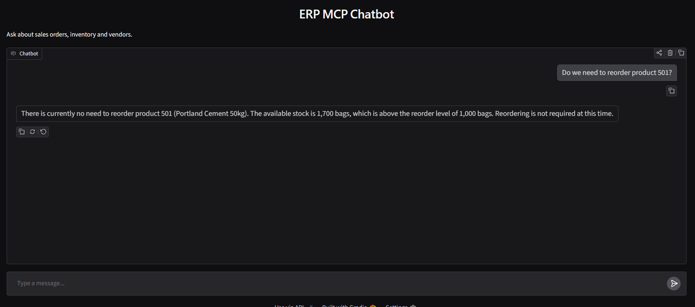
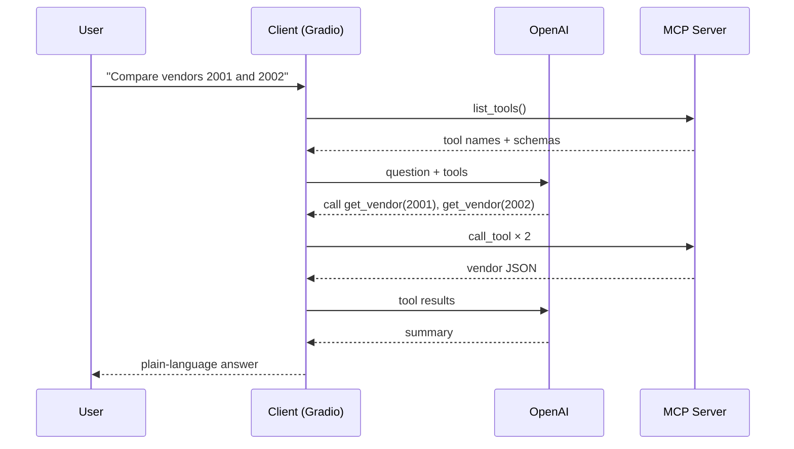

# ERP MCP Client

A chatbot that answers ERP business questions by discovering and calling tools on a remote [Model Context Protocol](https://modelcontextprotocol.io) server. OpenAI decides which tools to use; the client runs them over MCP and turns the raw data into a short business answer.

> **Requires [ERP MCP Server](https://github.com/mulangph/AI_MCP_Server)** to be running. That server provides the order, inventory and vendor tools.




## How it works



Tools are discovered at runtime, so adding a tool on the server makes it available here with no client changes. The model can call several tools in one turn and can take up to five rounds of tool calls per question.

## Quick start

Requires Python 3.12, [uv](https://docs.astral.sh/uv/), and an OpenAI API key.

**Terminal 1: start the server**

```bash
git clone https://github.com/mulangph/AI_MCP_Server.git
cd AI_MCP_Server
uv sync
uv run server.py
```

**Terminal 2: start the client**

```bash
git clone https://github.com/mulangph/AI_MCP_Client.git
cd AI_MCP_Client
uv sync
cp .env.example .env      # then add your OPENAI_API_KEY
uv run chatbot.py
```

Open the local link Gradio prints (usually http://127.0.0.1:7860).

## Configuration

| Variable | Required | Default | Purpose |
|---|---|---|---|
| `OPENAI_API_KEY` | Yes | — | OpenAI access |
| `OPENAI_MODEL` | No | `gpt-4.1` | Model used for reasoning and tool selection |
| `MCP_SERVER_URL` | No | `http://localhost:8000/mcp` | Where the MCP server is running |

## Try these questions

- `What is the status of order 12345?`
- `Do we need to reorder product 501?`
- `Compare vendors 2001 and 2002`
- `Which vendors have the best payment terms?`

## Project structure

```
AI_MCP_Client/
├── chatbot.py       # Gradio UI, MCP connection and tool-calling loop
├── .env.example
├── pyproject.toml
└── uv.lock
```

## Tech stack

Python 3.12, MCP Python SDK (streamable HTTP client), OpenAI Responses API, Gradio, and uv.

## Roadmap

- [ ] Keep conversation history between messages
- [ ] Reuse one MCP session instead of reconnecting per message
- [ ] Stream responses to the UI
- [ ] Tests with a mocked LLM

## License

MIT
